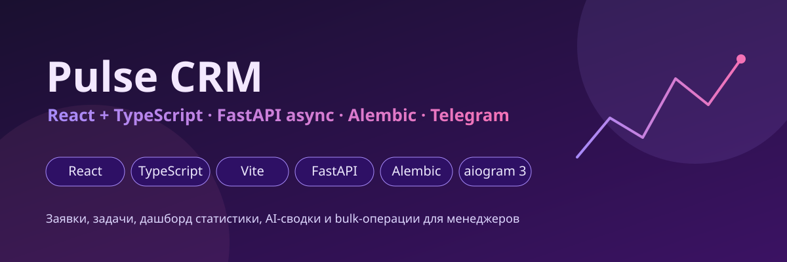
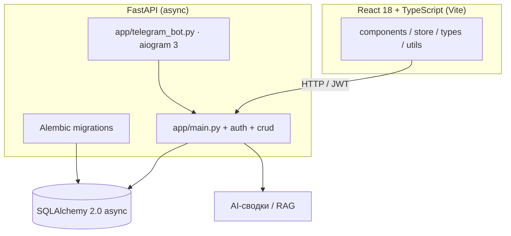
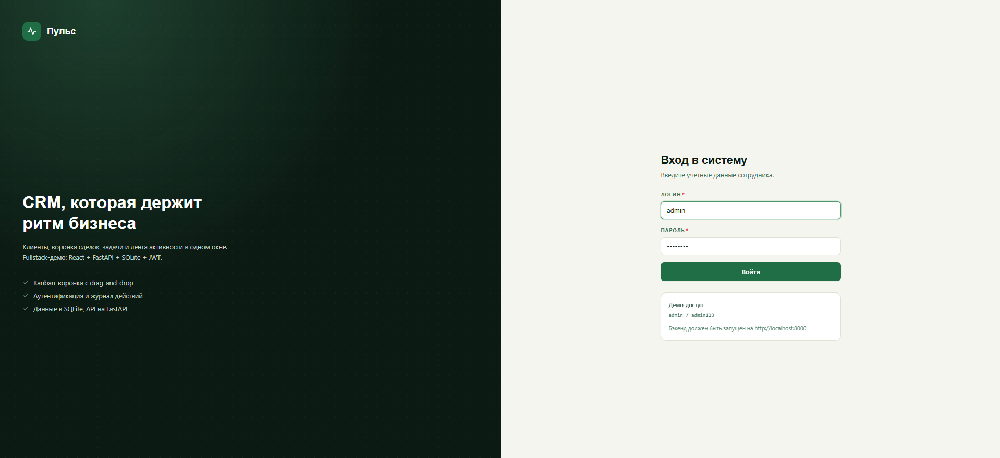
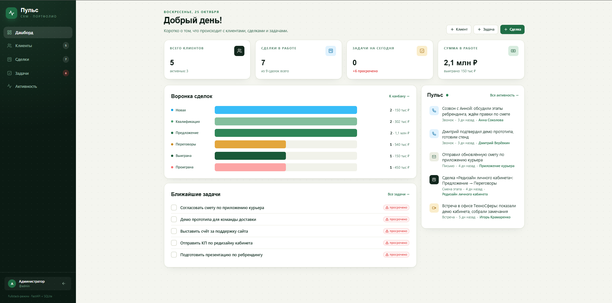
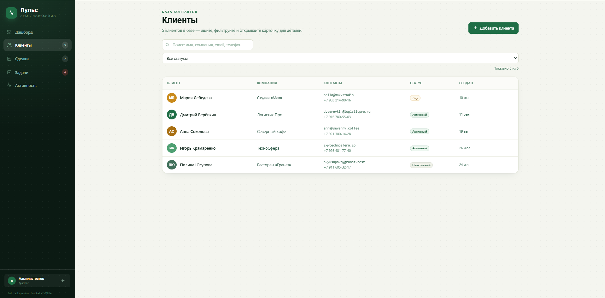
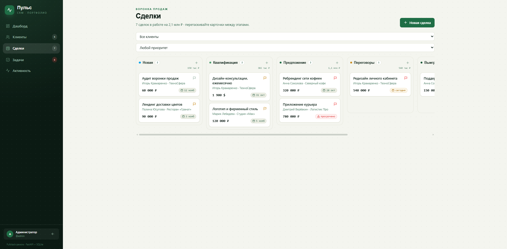
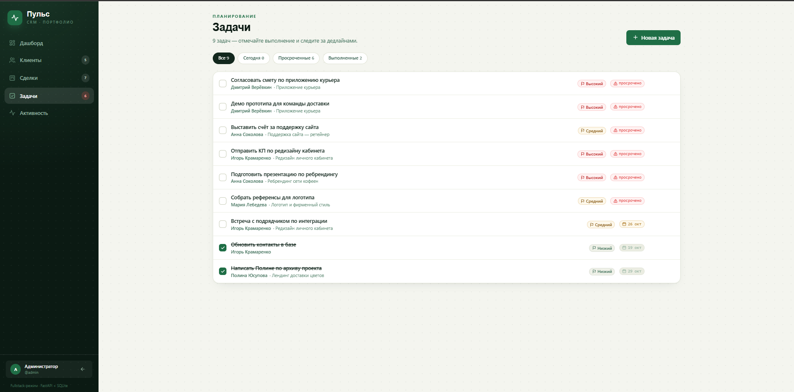

# Pulse CRM




Полноценный клиент-серверный CRM: SPA на React 18 + TypeScript (Vite, Tailwind) и асинхронный backend на FastAPI + SQLAlchemy 2.0 с миграциями Alembic. Заявки, задачи, статистика дашборда, AI-сводки, Telegram-интеграция и массовые операции (bulk) для менеджеров.

## Возможности

- **Заявки (requests)** — CRUD, статусы, фильтрация, история (ActionLog)
- **Задачи по заявкам** — назначение сотрудников, массовые операции: `bulk_update_status`, `bulk_assign_employees`
- **Дашборд** — статистика (`DashboardStats`), AI-сводки (`generate_ai_summary`)
- **Telegram** — приём заявок через бота, обновление статусов (`telegram_bot.py`), статистика канала
- **Авторизация** — JWT с refresh-токенами (`LoginRequest`, `RefreshTokenRequest`)
- **RAG-контекст** — подбор релевантного контекста для AI по заявке (`get_rag_context_for_request`)
- **UI-кит на React** — собственные компоненты: `Modal`, `Button`, `badges`, `Avatar`, `EmptyState`, `FormControls`, `PageHeader`, `Icon`

## Архитектура



## Быстрый старт

**Backend:**

```bash
python -m venv venv
venv\Scripts\activate
pip install -r requirements.txt
cp .env.example .env
alembic upgrade head
uvicorn app.main:app --reload     # http://localhost:8000
```

**Frontend:**

```bash
npm install
npm run dev                       # http://localhost:5173
npm run build                     # tsc && vite build
```

## Стек

| Слой | Технологии |
|---|---|
| Frontend | React 18, TypeScript 5, Vite 5, Tailwind CSS 3, react-router-dom 6 |
| Backend | FastAPI, SQLAlchemy 2.0 (asyncio), Alembic, pydantic v2 |
| Auth | JWT + refresh-токены, passlib/bcrypt |
| Telegram | aiogram 3.x |
| Quality | pytest, black, isort, mypy (в dev-зависимостях) |

## Скриншоты

| | |
|---|---|
|  |  |
|  |  |
|  |  |

---
Часть портфолио: [mini-crm](https://github.com/nwl01234/mini-crm) → [orbit-crm](https://github.com/nwl01234/orbit-crm) → **pulse-crm** · [business-flow-automator](https://github.com/nwl01234/business-flow-automator)
